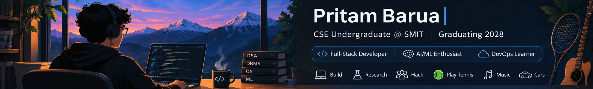

### Computer Science & Engineering Undergraduate · SMIT · Class of 2028

I enjoy building web applications, exploring AI/ML, and turning ideas into useful software.

---

## About Me

- 🎓 Pursuing a B.Tech in **Computer Science and Engineering** at Sikkim Manipal Institute of Technology.
- 💻 Interested in **Full-Stack Development, AI/ML, and DevOps**.
- 🧩 I enjoy building practical projects, exploring new technologies, and learning by building.
- 🏆 Reached the **Top 100 teams (Round 2)** at **WCC Forge 48 2026**.

---

## Tech Stack

**Languages**

**Web Development & Databases**

**Tools**

---

## Featured Projects

### 1. ContextFinder

An evidence-led project handover tool designed to help teams preserve important project context when a team member leaves.

*Forked from [Chief-Ethical-Programmer/ContextFinder](https://github.com/Chief-Ethical-Programmer/ContextFinder).*

### 2. Personal Expense Tracker

A full-stack expense tracking application featuring transaction management, category filtering, payment-method tracking, and interactive spending visualizations.

**Technologies:** Node.js · Express.js · MongoDB · Chart.js

### 3. Portfolio Website

My personal portfolio showcasing my background, technical skills, projects, and achievements.

---

## Research & Hackathons

### WCC Forge 48 2026 — ProjectPulse

- Reached the **second round (Top 100 among 1,000 teams)**.
- Contributed to frontend development and integrations.
- Worked on a solution focused on preserving project knowledge and generating structured team handovers.

### Audio Question Answering (AQA)

- Academic research project related to the DCASE 2025 Task.
- Exploring audio understanding and question-answering systems.

---

## GitHub Overview

---

### Always Learning. Always Building.

